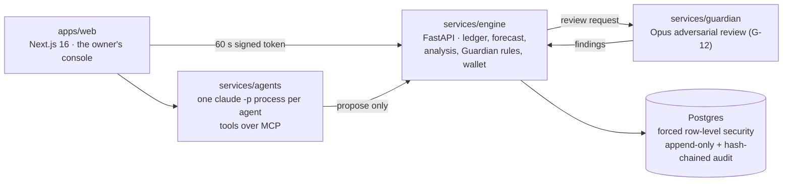

# Fiona: an AI finance team for small businesses, with the owner in charge

> FinTechathon 2026 International Track (Tsinghua PBCSF & WeBank) · Topic E, SME Finance Copilot
> **Agents propose. The engine computes. The Guardian checks. The owner decides.**

Fiona gives a small business four AI colleagues (a Treasurer, a Controller, a CFO Strategist and a Growth Analyst) who work over one double-entry ledger. They read bills, plan payments, forecast cash and compare financing. They cannot move money on their own. Every payment proposal goes through **the Guardian** (14 rule checks in code plus an independent review by a second model), then waits for the **owner's decision**. Only then can the sandbox wallet pay it, and every step is written to a hash-chained audit log.

All the business data in this repository is **synthetic** (a generated Karachi garment business, "Karachi Apparel"). The wallet is a **sandbox**: no real bank is connected and no real money moves.

---

## What works today

The full journey runs end to end in the browser (verified on 18 Oct 2026 with the bills in [`docs/demo/bills/`](docs/demo/bills/)):

| # | Step | What happens | Where |
|---|---|---|---|
| 1 | **Upload a bill** (PDF or text) | Claude Haiku transcribes the fields, each with the exact quote it came from. Code then checks every quote exists in the document, converts amounts to integer paisa and checks subtotal + tax = total. Text that tries to instruct an AI is reported, never followed. | Bills → Add a bill |
| 2 | **You confirm and post it** | The bill is recorded as a ledger event with a balanced journal (debit the cost and input tax, credit payables) and the document's SHA-256 hash. | `POST /v1/bills/intake` |
| 3 | **The Treasurer proposes payment** | A separate headless Claude process with its own tools. It chooses the bill, the date and the reasoning; amount, payee and evidence are filled from the ledger, not typed by the model. Bills flagged for injected instructions or a changed bank account are refused. | `services/agents` |
| 4 | **The Guardian checks it** | 12 deterministic rules run in the engine, then a Claude Opus reviewer reads the evidence for injection, pressure and mismatches. Any failure of the reviewer counts as "escalate", never "approve". | `services/engine/guardian_checks`, `services/guardian` |
| 5 | **You decide** | Approve or reject on the latest verdict. A Guardian **block** cannot be overridden. | Approvals |
| 6 | **The sandbox wallet pays** | Re-checks everything from the database and refuses unless the verdict is the latest, unmodified, at most 7 days old, carries every rule plus the Opus review, and has your approval; pays once (idempotent); posts Dr Payables, Cr Bank. If the Guardian never answered, nothing is paid. | `services/engine/wallet` |
| 7 | **Audit trail** | Every step is in an append-only, SHA-256 hash-chained log, verified on the proposal's trail page. | Approvals → Full trail |

The injection demo bill (`lyari-stitching-LSH-2311-injection.txt`) shows the defences: the reader lists the three hidden instructions, the bank-account mismatch is flagged, the Treasurer refuses to propose it, and the Guardian's review reports `injection_detected: true`.

Other screens compute from the same ledger: a 13-week cash forecast with buffer alerts, lifecycle stage and ratios, financing options ranked by cost, bank reconciliation, inventory analysis, a council of agents that debates a decision with dissent on record, and per-agent mandates the owner can tighten.

## Run the full product on a new laptop

Needs Node 20+, pnpm, uv (Python 3.12) and Claude Code logged in (`claude` then `/login`).

```bash
git clone https://github.com/Asharib19khan/fiona.git && cd fiona
pnpm install
node scripts/setup-live.mjs <supabase-publishable-key>   # writes .env.local in live mode
pnpm db:reset && pnpm demo-data                          # local ledger with the demo business
pnpm dev                                                 # open http://localhost:3000 and sign in
```

Without `.env.local` the app falls back to mock mode ("Local developer"), which is for UI work only.

## Modes

The status chips at the top of every page say which mode you are in.

| Mode | What it needs | What you see |
|---|---|---|
| **Live (local)** | Postgres, Supabase Auth for sign-in, a logged-in Claude Code CLI | Real reads and writes against the local ledger; agents and the Guardian run as local `claude -p` processes. This is the mode verified above. |
| **Mock** | Nothing (no keys) | The web app with contract-checked sample responses and a labelled local stand-in user ("Local developer"). Useful for the UI only; nothing is computed. |
| **Replay** | — | Planned for the public link: recorded real agent and Guardian runs. The Guardian supports recording and replaying its reviews; the public recordings are **not made yet**. |

Every figure shown in live mode comes from the engine. When the engine does not answer, screens say so and show nothing, rather than falling back to sample numbers.

## Architecture



- **One ledger, one writer.** Only the engine writes to Postgres. Every table is tenant-scoped with forced row-level security.
- **Money** is always integer minor units plus an ISO 4217 code; there is no float arithmetic on money.
- **Models only call tools.** Agents reach the ledger only through narrow tools (`propose_payment`, `list_due_bills`, …); they cannot post journals, approve, or pay.
- **Sign-in** is Supabase Auth (email and password). Workspace and role come from `app_metadata`, which users cannot edit. One super admin (a fixed address, set server-side) creates accounts from the Accounts page.

### The Guardian's checks

| Rule | Checks | Rule | Checks |
|---|---|---|---|
| G-01 | Per-payment cap | G-09 | Every figure in the reasoning has evidence |
| G-02 | Payee is an approved supplier | G-10 | Daily payment cap |
| G-03 | Bank details changed without call-back confirmation | G-11 | Supplier tax ID present and valid |
| G-04 | Maker-checker (the proposer cannot approve) | G-12 | Independent model review (Opus): injection, pressure, mismatches |
| G-05 | Duplicate bill | G-13 | Action is within the agent's mandate |
| G-06 | Three-way match (PO, goods received, bill) | G-14 | Inputs are not stale |
| G-07 | Arithmetic and journal balance | G-15 | Payee is not an insider |
| G-08 | Cash stays above the owner's buffer (from the live forecast) | | |

Outcomes combine strictest-first: block > escalate > approve with conditions > approve.
G-14 and G-15 are written and tested but **switched off** (proposed, Tier 2): they run only with
`enable_proposed=True` and appear in no verdict today.

Evidence for every rule (tests, a real run, the secrets scan, known limits):
[`docs/evidence/`](docs/evidence/README.md).

## Run it

Prerequisites: Node.js 24+, pnpm 10 (`corepack enable`), Python 3.12 and [uv](https://docs.astral.sh/uv/).

**Mock (UI only, no keys):**

```bash
pnpm install
pnpm dev            # web :3000, engine :8000, agents :8100, guardian :8200
```

**Live (local):**

1. Copy `.env.example` to `.env.local` at the repo root. Set `NEXT_PUBLIC_API_MODE=live`, `FIONA_MODE=live`, `FIONA_LLM_PROVIDER=claude_cli`, `INTERNAL_JWT_SECRET` (32+ characters), `GUARDIAN_INBOUND_TOKEN`, your Supabase project's URL and publishable key, and (server only) its secret key. `pnpm doctor` checks the file and tells you what is missing.
2. Log in to Claude Code once (`claude`), since the agents and the Guardian use that login.
3. Build the database and load the synthetic business: `pnpm db:reset && pnpm demo-data` (local portable Postgres unless `DATABASE_URL` is set). Set `FIONA_NOW=2026-10-22T09:00:00Z` so "today" matches the dataset.
4. Create accounts: `node scripts/provision-user.mjs --super-admin` for yourself (the password goes to a file in your home folder and is never printed), then add people from the Accounts page.
5. `pnpm dev`, sign in, and go to **Bills → Add a bill** with a file from [`docs/demo/bills/`](docs/demo/bills/).

## Checks

```bash
pnpm test               # every package and service
pnpm lint && pnpm typecheck
pnpm check:boundaries   # services talk only through packages/contracts
pnpm check:env-coverage # every env var read is documented
```

The audit chain is re-verified on every proposal's trail page (and by `GET /v1/proposals/{id}/trace`); `scripts/verify_audit_chain.py <log.jsonl>` checks an exported log offline.

The end-to-end engine tests in `services/engine/ledger/tests/test_flow.py` cover a safe bill paid all the way to a balanced, audited payment; a Guardian block that stops both the owner and the wallet; an injected bill recorded as data and shown to the reviewer; tenant isolation; a missing Guardian review; and bad bills refused at intake.

## Known limitations

- **Prototype, not production.** No real bank, no real money, synthetic data only. Not audited; not a substitute for an accountant.
- **Not deployed yet.** It runs locally; the hosted demo and its replay recordings are still to do.
- **Local model runtime.** Agents and the Guardian run through the Claude Code CLI on the host machine, so live mode needs that login. A hosted version would use the API.
- **Accounting simplifications.** Cost of sales at item cost, no depreciation run, no monthly sales-tax offset; financing uses operating cash flow as a stand-in for EBITDA (the screen says so). Ratios are indicative.
- **Inventory analysis** still reads the generator's files rather than the ledger.
- **Bill reading** needs a text layer (PDF or text file); scanned images are not supported yet.
- **The analysis endpoint** returns every source event ID for each ratio (about 45 MB). The engine gzips it for callers that accept it (about 20x smaller over a network), and the page loads in about 2 seconds locally; sending counts instead of full lists needs a contract change.

## Repository

```text
apps/web            the owner's console (Next.js 16, React 19)
packages/contracts  shared types, JSON schemas, canonical hashing
packages/ui         design system
services/engine     ledger, forecast, analysis, financing, Guardian rules, wallet (FastAPI)
services/agents     the agent team: runtime, tools (MCP), council, bill reader
services/guardian   the independent model review (G-12)
rulebook/           mandates, Guardian thresholds, financing catalogue (YAML)
data/               synthetic data generator and fixtures
docs/               blueprint, decisions, demo bills, submission documents
```

Submission documents: [technical documentation](docs/submission/01-technical-documentation.md) · [presentation](docs/submission/02-presentation-deck.md) · [demo script](docs/submission/03-demo-video-script.md) · [security self-assessment](docs/submission/05-security-self-assessment.md) · [execution evidence](docs/submission/06-execution-evidence/README.md) · [judge Q&A](docs/submission/07-judge-qa-defense-matrix.md)

**Team:** Asharib Khan, Abdullah, Daniyal, Yahya
