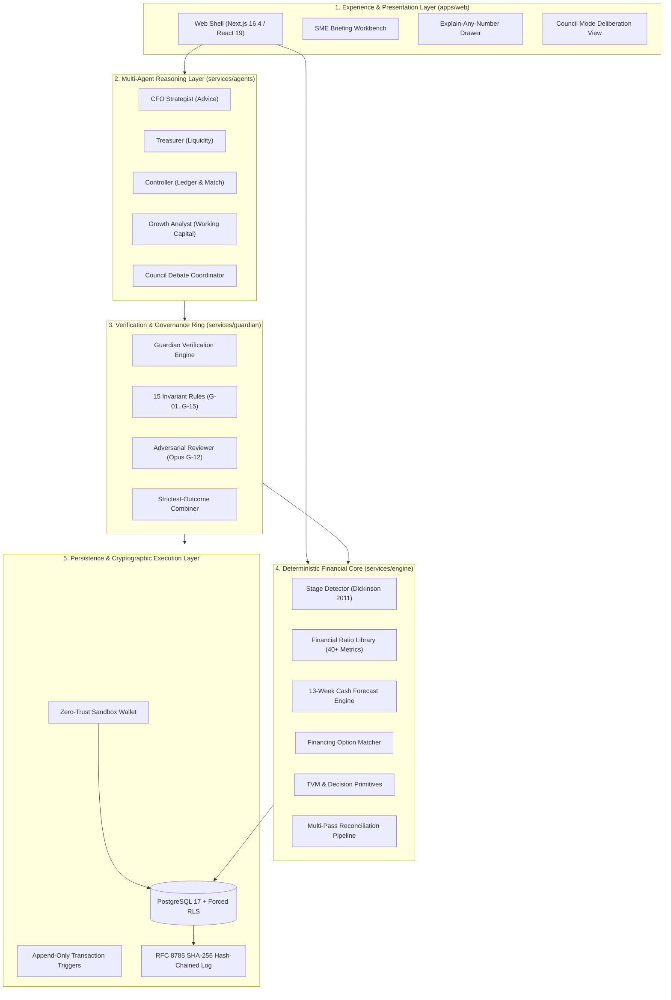

# Fiona: The Autonomous AI Finance Team for SMEs

[](https://nextjs.org/)
[](https://turbo.build/)
[](https://fastapi.tiangolo.com/)
[-brightgreen)]()
[]()
[-purple)]()

> **Competition Track:** FinTechathon 2026 International Track (Tsinghua PBCSF & WeBank)  
> **Topic:** **E — SME Finance Copilot**  
> **Core Principle:** $\mathbf{The\ Model\ Decides\ \longrightarrow\ The\ Engine\ Computes\ \longrightarrow\ The\ Guardian\ Checks}$  
> **Repository:** [https://github.com/Asharib19khan/fiona](https://github.com/Asharib19khan/fiona)

---

## 1. Executive Overview

Small-to-medium enterprises (SMEs) represent the backbone of global commerce yet suffer from the highest vulnerability to cash-flow insolvency. SME founders excel at their operational trade but rarely possess training in double-entry bookkeeping, treasury forecasting, working-capital optimization, or credit-risk underwriting.

**Fiona** is an enterprise-grade multi-agent autonomous finance copilot that acts as a full AI finance team (CFO Strategist, Treasurer, Controller, Growth Analyst) governed by an independent deterministic risk gatekeeper: **The Guardian**. 

Unlike conversational wrappers that feed raw balance sheets into unstructured LLM prompts, Fiona operates on a mathematical **separation of powers**:
- **Agents propose** actions (bill payments, financing applications, inventory reorders).
- **The Engine computes** deterministic financial truths (13-week direct cash forecasts, Dickinson lifecycle stages, DSCR ratios).
- **The Guardian checks** 15 invariant policies before any simulated payment or ledger mutation can occur.

---

## 2. Topic E Alignment & Official Capabilities Matrix

| Official Tsinghua / WeBank Requirement | Fiona Delivered Architecture | Code Traceability | Verification & Tests |
| :--- | :--- | :--- | :--- |
| **"A finance copilot for small-business owners..."** | Multi-agent council with 3-tier Autonomy Ladder, human-in-the-loop review, and multilingual voice command bar (English, Urdu, Chinese). | `services/agents/`<br>`apps/web/app/` | `pnpm --filter @fiona/web test`<br>`scripts/check-boundaries.py` |
| **"...offering financing-option matching..."** | Multi-criteria matcher across 20 regional debt/equity instruments (Pakistan SBP & China SME products) with post-borrowing DSCR capacity checks. | `services/engine/financing/`<br>`rulebook/financing.yaml` | `services/engine/financing/tests/`<br>`test_coverage.py` |
| **"...cash-flow management with alerts..."** | 13-week direct cash forecast from immutable ledger events, detecting liquidity buffer breaches and optimizing 2/10 net 30 payment timing (44.6% APR). | `services/engine/forecast/`<br>`services/engine/decisions/tvm.py` | `services/engine/forecast/tests/`<br>`test_cash_forecast.py` |
| **"...and business financial analysis."** | Empirical lifecycle Stage Detector after Dickinson (2011), 40+ financial ratio library, health score grading, and POS reconciliation. | `services/engine/analysis/stage.py`<br>`services/engine/analysis/ratios.py` | `test_stage.py`<br>`test_ratios.py` |

---

## 3. System Architecture: 5 Decoupled Layers



---

## 4. Flagship Innovations & Core Features

### 1. Dickinson (2011) Cash Flow Lifecycle Stage Detection
Replaces static balance-sheet snapshots with empirical cash-flow signature analysis across Operating ($O$), Investing ($I$), and Financing ($F$) cash flows:
$$\text{Stage} = f(\text{sgn}(CF_O), \text{sgn}(CF_I), \text{sgn}(CF_F)) \in \{\text{Introduction, Growth, Mature, Shake-Out, Decline}\}$$
Prevents premature debt issuance when an SME is entering shake-out or decline phases.

### 2. 13-Week Cash Forecasting & Early-Payment Discount Optimization
Calculates the true effective annualized return of vendor payment discounts:
$$\text{APR} = \frac{d}{1 - d} \times \frac{365}{t_{\text{due}} - t_{\text{disc}}}$$
A standard `2/10 net 30` discount yields an **annualized return of 44.59%**. Fiona automatically balances discount capture against the tenant's mandatory liquidity buffer.

### 3. The 15 Guardian Invariant Rules (G-01..G-15)
Every financial proposal must run the Guardian gauntlet:
- **G-01 Arithmetic Verification**: Enforces zero float math; subtotal + tax = total.
- **G-03 Bank Details Verification**: Blocks Business Email Compromise (BEC) and bank detail changes without multi-factor authorization.
- **G-08 Mandate Spending Caps**: Hard stops actions exceeding per-payment or daily autonomy ceilings.
- **G-12 Adversarial Prompt Injection Defense**: Quarantines untrusted invoice text and validates proposals against prompt-injection attacks.
- **G-14 & G-15 Regulatory Sanctions & Capital Preservation Checks**.

### 4. Multi-Agent Council Mode with Dissent on Record
When facing complex decisions (e.g., debt financing vs. angel equity), Fiona's agents convene a structured council. If the CFO advocates borrowing but the Treasurer warns of a week-7 liquidity shortfall, the debate is captured in a formal memo with **dissent permanently on record**.

### 5. Cryptographic Audit Log & Zero-Trust Sandbox Wallet
- **RFC 8785 Canonical JSON Serialization** + SHA-256 hash chaining: every entry includes `prev_hash`, creating an immutable ledger chain.
- Verified using `python scripts/verify_audit_chain.py` (0 tampering tolerance).

---

## 5. Monorepo Structure

```text
├── apps/
│   └── web/                 # Next.js 16.4 App Router console (the Window)
├── packages/
│   ├── contracts/           # Pydantic & TS models, JSON Schemas, RFC 8785 hashing
│   └── ui/                  # Design system tokens and accessible UI primitives
├── services/
│   ├── engine/              # FastAPI financial core: ledger, forecast, stage, ratios, DB
│   ├── agents/              # Multi-agent runtime (Haiku extract, Sonnet reasoning, CLI bridge)
│   └── guardian/            # Invariant rules G-01..G-15 & adversarial reviewer
├── rulebook/                # YAML country packs (PK, CN), mandates, and financing catalog
├── docs/
│   ├── submission/          # Official FinTechathon 2026 Deliverables (01 to 07)
│   └── orchestrator/        # Team roadmap, PLAN.md, and architecture decisions
└── scripts/                 # Boundaries check, env coverage, and audit chain verifier
```

---

## 6. Quickstart & Local Evaluation

### Prerequisites
- **Node.js** $\ge 24$ (managed via Corepack)
- **Python** 3.12 and [uv](https://docs.astral.sh/uv/)
- **pnpm** 10.34.6 (`corepack enable`)

### 1. Zero-Secret Local Demo (Instant Run)
Fiona runs completely offline using deterministic contract-backed **Seed-42 synthetic fixtures**. No API keys or external services are required:

```bash
# 1. Install dependencies
pnpm install

# 2. Diagnostic environment health check
pnpm doctor

# 3. Start all services (Web :3000, Engine :8000, Agents :8100, Guardian :8200)
pnpm dev
```

Open [http://localhost:3000](http://localhost:3000) in your browser.

### 2. Multi-Model Claude CLI Bridge (No API Keys Needed)
Fiona supports a **headless terminal connection** to Claude Code CLI, allowing multi-model dispatching without paying for direct API keys:
- Fast extraction tasks route to **Haiku**
- CFO / Treasurer financial reasoning routes to **Sonnet**
- Guardian adversarial review routes to **Opus**

```bash
# Enable the terminal CLI bridge
export FIONA_LLM_PROVIDER=claude_cli
pnpm dev
```

---

## 7. Verification & Self-Testing Commands

Evaluate Fiona's mathematical correctness and security isolation:

```bash
# Run all 432 unit & property tests across the monorepo
pnpm test --force

# Verify architectural static import boundaries
python scripts/check-boundaries.py

# Verify cryptographic audit chain integrity
python scripts/verify_audit_chain.py

# Verify environment variable coverage
pnpm check:env-coverage

# Build optimized production bundle
pnpm build
```

---

## 8. Official Submission Deliverables Index

| Deliverable | Document File | Description |
| :--- | :--- | :--- |
| **01 Technical Documentation** | [`docs/submission/01-technical-documentation.md`](docs/submission/01-technical-documentation.md) | Exhaustive 360-line specification of architecture, algorithms, and models |
| **02 Presentation Deck** | [`docs/submission/02-presentation-deck.md`](docs/submission/02-presentation-deck.md) / [HTML Deck](docs/submission/presentation-deck.html) | 13 structured slides with verbatim 9m 30s speaker notes |
| **03 Demo Video Script** | [`docs/submission/03-demo-video-script.md`](docs/submission/03-demo-video-script.md) | Timed 4m 45s shot-by-shot script demonstrating DEMO-1 fraud prevention |
| **04 Source Code** | [This Repository](https://github.com/Asharib19khan/fiona) | Fully tested, reproducible monorepo codebase |
| **05 Security Assessment** | [`docs/submission/05-security-self-assessment.md`](docs/submission/05-security-self-assessment.md) | STRIDE threat model, 15 Guardian rules, RLS policies, known-risk register |
| **06 Execution Evidence** | [`docs/submission/06-execution-evidence/README.md`](docs/submission/06-execution-evidence/README.md) | 1MB operations log, 13-entry verified audit chain, verification report |
| **07 Defense Matrix** | [`docs/submission/07-judge-qa-defense-matrix.md`](docs/submission/07-judge-qa-defense-matrix.md) | Judge technical defense matrix with mathematical proofs & code citations |

---

## 9. Synthetic Data Disclosure

All company names, suppliers, bank accounts, tax identifiers, and transaction amounts in this repository are **100% synthetic**, generated by `data/generator`. No real-world financial records or customer PII are stored or processed.

---

**License:** MIT  
**Authors:** Asharib Khan, Abdullah, Daniyal, Yahya (Team Fiona)
