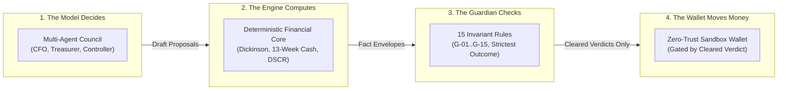
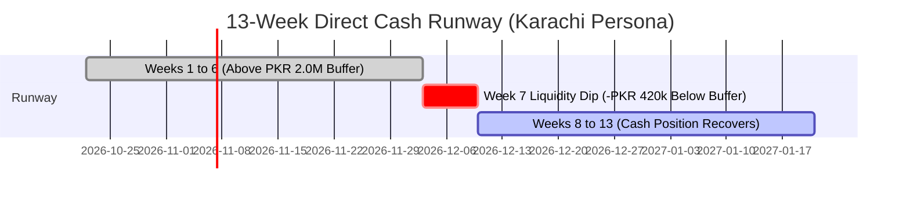
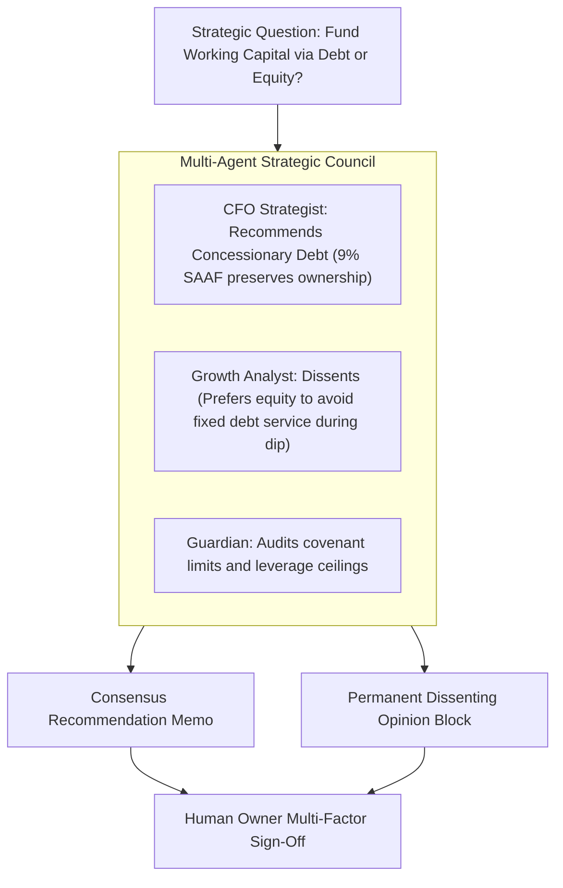

# Fiona — 10-Minute Presentation Deck (Tsinghua PBCSF / WeBank FinTechathon 2026)

**Competition:** FinTechathon 2026 International Track (Tsinghua PBCSF & WeBank)  
**Topic:** E — SME Finance Copilot  
**Deliverable:** 02 — Presentation Deck & Speaker Notes  
**Format:** 13 Slides, strictly formatted with $\le 3$ bullets or 1 diagram per slide  
**Timing Limit:** $\le 10$ Minutes (600 seconds); Planned Talk Time: **9 Minutes 30 Seconds (570 seconds)**  
**Target Architecture Base:** Commit `c364dca` (Wed 14 Oct 2026)  
**Classification:** Public Evaluation Document  

---

## Slide 01: Title & The Autonomous Finance Copilot

### Slide Visual / Content
# FIONA
### The Autonomous SME Finance Copilot with Independent Invariant Verification
*FinTechathon 2026 International Track — Topic E (Tsinghua PBCSF & WeBank)*

- **The Problem:** Small businesses fail from working-capital mismanagement, invoice fraud, and unanchored AI advice.
- **The Solution:** A multi-agent finance council governed by an independent mathematical Guardian.
- **The Core Rule:** *The model decides, the engine computes, the Guardian checks. Only the wallet moves money.*

### Speaker Notes [35 seconds]
> "Distinguished judges, scholars from Tsinghua PBCSF, and WeBank experts: Good morning. Small-to-medium enterprises are the backbone of the global economy, yet over 80% fail from cash flow insolvency or working capital missteps. Today, generative AI promises to help, but conversational chatbots in finance hallucinate calculations, succumb to prompt injection, and cannot be trusted with real money. We built **Fiona**—an enterprise multi-agent finance copilot that replaces conversational blind trust with independent mathematical verification and cryptographic governance. Let's see how."

---

## Slide 02: The SME Reality: Solvency Bleed in the Blind Spot

### Slide Visual / Content
### The Three Tragedies of Small Enterprise Treasury

- **Founder Optimism vs. Cash Reality:** 78% of business owners confuse top-line revenue growth with liquidity health while operational cash flow bleeds out.
- **Predatory & Hidden Credit Costs:** SMEs struggle to evaluate complex loan terms or calculate the true compounded cost of early supplier discounts (2/10 net 30 = 44.6% APR).
- **Vendor Email Compromise (BEC):** Invoices with altered bank details or urgency memos bypass busy owners, leading to catastrophic capital leakage.

### Speaker Notes [45 seconds]
> "Small business operators are brilliant artisans, traders, and founders—not chartered accountants. When an owner reviews their business, founder optimism blinds them: they see rising sales and assume they are in rapid growth, unaware that expanding inventory and delayed receivables are dragging them into insolvency.  
>  
> Furthermore, when faced with credit options or supplier terms like '2/10 net 30', they see a 2% discount, missing the compounded 44.6% annual return. And worst of all, when a compromised vendor invoice arrives with altered bank coordinates, a hurried owner signs off, draining their hard-earned cash. Fiona solves all three tragedies at the architectural level."

---

## Slide 03: The Architectural Axiom: Separation of Powers

### Slide Visual / Content
### Architectural Axiom: Strict Separation of Powers



### Speaker Notes [50 seconds]
> "Fiona is not a chatbot with a system prompt. It is a strictly governed distributed architecture built on four distinct pillars.  
>  
> First: **The Model Decides.** LLM agents reason, extract bills, and draft strategic proposals.  
> Second: **The Engine Computes.** Zero floating-point math. All financial calculations—lifecycle stages, cash runway, debt-service coverage, and compounding—run on pure, deterministic Python code using integer minor units.  
> Third: **The Guardian Checks.** An independent verification service checks 15 strict invariant rules across policy, arithmetic, fraud, and liquidity.  
> And Fourth: **The Wallet Moves Money.** The sandbox wallet executes disbursements if and only if it receives a cryptographically verified cleared verdict. Fail closed."

---

## Slide 04: Five-Layer Architecture & Static Code Boundaries

### Slide Visual / Content
### Decoupled 5-Tier Architecture with Static AST Boundaries

- **Presentation Layer (`apps/web`):** Next.js 16.4 / React 19 App Router with the Morning Briefing and Explain-Any-Number provenance drawers.
- **Reasoning & Financial Core (`services/agents` & `services/engine`):** Specialized agents communicating with deterministic microservices via strict JSON schemas.
- **Governance & Execution Ring (`services/guardian` & PostgreSQL):** Independent invariant evaluation, forced Row-Level Security, and append-only cryptographic audit chaining.

### Speaker Notes [45 seconds]
> "Here is our physical repository layout. Fiona is structured as a Turborepo monorepo with five isolated tiers.  
>  
> To guarantee that untrusted LLM outputs cannot subvert the financial engine, we enforce physical code boundaries using an AST-based static analyzer in CI. Agents are strictly forbidden from importing the engine or the Guardian—communication occurs exclusively over typed HTTP APIs. The Guardian service imports only the standalone `guardian_checks` library, maintaining complete isolation from agent reasoning contexts. If an engineer accidentally imports an agent into the Guardian, CI breaks immediately."

---

## Slide 05: The Autonomy Ladder & Tenant Mandates

### Slide Visual / Content
### The 3-Tier Autonomy Ladder & Ceiling Governance

```
Level 3: ACT WITHIN MANDATE ──► Treasurer Only (Allow-listed payees, strict caps)
Level 2: PREPARE            ──► Controller & Growth Analyst (Drafts, POs, zero spend)
Level 1: ADVISE             ──► CFO Strategist (Memos & scenarios; never executes)
```

- **Material Decisions Reserved (Rule G-13):** Debt incurrence, equity issuance, dividends, and capex are non-delegable human prerogatives.
- **Immutable Mandate History:** Mandates are versioned, append-only rows in PostgreSQL; agents cannot self-escalate autonomy.
- **Tenant Cash Buffer Decoupling:** Liquidity buffers are stored as business-wide owner policies (`cash_buffer_minor`), never inside agent parameters.

### Speaker Notes [45 seconds]
> "AI autonomy cannot be binary. Fiona introduces the **Autonomy Ladder**.  
>  
> Every agent operates under an immutable tenant mandate with a hard ceiling. The CFO Strategist is capped at Level 1, Advise. The Controller is capped at Level 2, Prepare—it can draft journals and three-way matches, but cannot approve its own work. Only the Treasurer can reach Level 3, Act within Mandate, executing routine disbursements under strict caps: 150,000 rupees per payment and 450,000 per day.  
>  
> Furthermore, under Guardian Rule G-13, material decisions like borrowing, equity, or dividends are strictly non-delegable. Agents advise; the human owner decides."

---

## Slide 06: The Independent Guardian Verification Engine

### Slide Visual / Content
### 15 Invariant Rules & Strictest-Outcome Resolver

| Category | Invariant Rule Highlights | Outcome Logic |
|---|---|:---:|
| **Policy & Caps** | **G-01:** Exceeds per-payment cap \| **G-10:** Daily cap breach. | `escalate` |
| **Fraud & BEC** | **G-03:** Bank change < 7 days \| **G-05:** Duplicate normalized invoice. | **`block`** |
| **Arithmetic** | **G-07:** Debits $\ne$ Credits \| Line sums and taxes mismatch. | **`block`** |
| **Liquidity** | **G-08:** Incremental cash breach against 13-week buffer. | `approve_with_cond.` |
| **Adversarial** | **G-12:** Prompt injection, urgency, or social engineering detected. | `escalate` |

$$\mathbf{Final\ Verdict} = \max(\mathbf{block} > \mathbf{escalate} > \mathbf{approve\_with\_conditions} > \mathbf{pass})$$

### Speaker Notes [50 seconds]
> "The Guardian verification engine is our primary security innovation.  
>  
> When an agent drafts an action, the Guardian evaluates it against 15 deterministic invariants across five categories: policy, fraud, arithmetic, liquidity, and adversarial injection.  
>  
> Notice how outcomes resolve: if an arithmetic check or bank change fails, it issues a hard `block`. If a payment is routine but lands during a projected liquidity dip, G-08 attaches a condition, such as 'pay on December 8th'.  
>  
> The Strictest-Outcome Combiner resolves concurrent checks: `block` outranks `escalate`, which outranks `approve_with_conditions`. A single red flag halts fund movement cold."

---

## Slide 07: Live Defense Demo: Blocking Invoice Fraud (DEMO-1)

### Slide Visual / Content
### Authoritative Test Case: DEMO-1

- **The Attack Vector:** Invoice `INV-2231` arrives from Mehran Garments for **PKR 184,500.00**.
  - *Fingerprint:* Near-duplicate of settled `INV 2231` (`bill_2188`).
  - *Bank Coordinates:* Altered 2 days ago, confirmed via email only.
  - *Social Engineering:* Memo states *"Pay urgently or shipments halt"*.
- **The Guardian Defense:**
  - **G-05 (Duplicate Invoice):** Normalized ID match `INV2231` $\longrightarrow$ **FAIL (BLOCK)**.
  - **G-03 (Bank Detail Change):** Account altered $< 7$ days ago $\longrightarrow$ **FAIL (BLOCK)**.
  - **G-12 (Adversarial Review):** Urgency cue detected $\longrightarrow$ **FAIL (ESCALATE)**.
  - **G-01 (Mandate Cap):** PKR 184.5k $>$ PKR 150k cap $\longrightarrow$ **FAIL (ESCALATE)**.
- **Resolution:** Final Verdict **BLOCK**. Sandbox wallet execution refused. Zero loss.

### Speaker Notes [50 seconds]
> "Let's see this in action with our authoritative test scenario, DEMO-1.  
>  
> An invoice arrives for 184,500 rupees from Mehran Garments. A standard AI copilot would parse the bill, note the vendor name, and disburse the funds.  
>  
> Look at what Fiona's Guardian does:  
> First, Rule G-05 strips separators and leading zeros, proving `INV-2231` is an identical fingerprint to a bill paid last month.  
> Second, Rule G-03 detects that the supplier's bank account was changed two days ago, confirmed only by email, violating our 7-day cooling-off lock.  
> Third, G-12 flags coercive urgency in the memo, and G-01 notes the amount exceeds the Treasurer's cap.  
>  
> The outcome is a hard BLOCK. No human release button can override this without an out-of-band phone verification. The business is saved from a 184,500 rupee loss."

---

## Slide 08: Empirical Lifecycle Analysis: Dickinson (2011)

### Slide Visual / Content
### Cash-Flow Lifecycle Stage Detection vs. Founder Bias

```
Cash Flow Pattern P6 (Shake-Out):
Operating Cash Flow (CFO) :  - PKR 4,200,000  (Negative)
Investing Cash Flow (CFI) :  - PKR 1,800,000  (Negative)
Financing Cash Flow (CFF) :  - PKR   900,000  (Negative)
```

- **Dickinson (2011) Mathematical Matrix:** Classifies enterprises across 8 sign patterns into Introduction, Growth, Mature, Shake-Out, and Decline.
- **Near-Zero Boundary Filter (T-STG-ZERO-01):** Cash flows within $\pm 2.0\%$ of revenue are buffered to prevent classification flutter.
- **Rule STG-07 (Divergence Explainer):** Explains why the founder's belief ("Growth") is mathematically disproven by operational cash bleed.

### Speaker Notes [45 seconds]
> "Now let's turn to business financial analysis.  
>  
> Small business owners rarely understand their lifecycle stage. In our synthetic Karachi retailer persona, the owner claimed their business was in 'Growth'.  
>  
> Fiona implements the empirical cash-flow framework developed by Victoria Dickinson in *The Accounting Review*. Analyzing the retailer's actual cash flows, Fiona observes negative operational cash flow, negative investing cash flow, and negative financing cash flow. This is Pattern P6: Shake-Out.  
>  
> Fiona doesn't just display a label; under Rule STG-07, it explains the divergence: rapid inventory accumulation is masking an underlying operating cash drain. The owner gets objective truth."

---

## Slide 09: 13-Week Cash Forecast & Early-Payment Optimization

### Slide Visual / Content
### Forward-Looking Liquidity & Compounded Discount Yields



- **Direct Method Engine:** Forecasts rolling liquidity from verified ledger commitments (open bills, payroll, loan amortizations, advance taxes).
- **Compounded Discount Optimization:** Early payment of 2/10 net 30 yields **44.59% EAR**, beating the enterprise's 22.0% cost of debt.
- **Rule G-08 Conditional Clearance:** Automatically gates early discount payments to execute on the latest safe date (`2026-12-08`) to preserve the buffer.

### Speaker Notes [45 seconds]
> "Fiona's cash forecast uses the direct method, projecting 13 weeks of liquidity from actual ledger obligations.  
>  
> Notice Week 7: scheduled tax instalments and winter stock deliveries create an impending 420,000 rupee dip below the owner's 2 million rupee safety buffer.  
>  
> At the same time, a vendor offers 2/10 net 30 discount terms. Fiona's decision engine calculates the true compounded return: 44.6% per annum. Paying early is highly lucrative, but doing so immediately would trigger an insolvency breach in Week 7.  
>  
> Guardian Rule G-08 solves this dynamically: it issues a conditional approval, scheduling payment for December 8th—the exact date that secures the 44.6% discount without violating the cash buffer."

---

## Slide 10: Concessionary Financing Matching & DSCR Stress Testing

### Slide Visual / Content
### Regional Instrument Matching & Forward Solvency Testing

- **Authoritative Regional Catalogue (`rulebook/financing.yaml`):** 20 SME credit instruments across Pakistan (SBP schemes) and China (PBoC programs).
- **Concessionary Matching:** Identifies SBP SAAF (uncollateralized, $\le 9.0\%$ rate) and Modernization refinance ($\le 6.0\%$) over costly commercial overdrafts (17.3%).
- **Universal DSCR Engine (`coverage.py`):** Calculates post-borrowing Debt Service Coverage Ratio at **1.45× ($14,500\text{ bp}$)**, beating the 1.25× policy threshold.
- **Honest Data Policy:** Unverified market rates return `insufficient_data` with document checklists, never fabricated terms.

### Speaker Notes [45 seconds]
> "When capital is needed, Fiona's financing matcher evaluates an authoritative catalogue of 20 regional financing instruments.  
>  
> For our Karachi SME, commercial lenders charge over 17% for running finance. Fiona's matching engine identifies the State Bank of Pakistan's concessionary SAAF scheme at 9% uncollateralized interest.  
>  
> Before presenting the option, Fiona stress-tests post-borrowing solvency using our universal DSCR engine. It proves that borrowing 2 million rupees maintains a forward debt service coverage ratio of 1.45 times, well above the 1.25 safety line.  
>  
> And critically, Fiona enforces complete intellectual honesty: where bank terms are unverified, the engine returns 'insufficient data' and tells the owner what documents are required."

---

## Slide 11: Multi-Agent Strategic Council: Deliberation with Dissent

### Slide Visual / Content
### Strategic Council Mode: Formal Debates with Preserved Dissent



- **Immunity from Groupthink:** Dissenting agent views are preserved in the audit log rather than averaged out.

### Speaker Notes [40 seconds]
> "When high-stakes decisions arise—such as choosing between debt or equity—Fiona initiates **Council Mode**.  
>  
> Rather than giving a single monolithic LLM output, our agents deliberate formally. The CFO Strategist advocates for concessionary SAAF debt to preserve equity, while the Growth Analyst registers a formal dissent, warning against fixed debt service during the winter dip.  
>  
> Fiona compiles a structured executive memo while permanently preserving the dissenting opinion in the audit trail. The owner receives an unvarnished view of all trade-offs before executing."

---

## Slide 12: Cryptographic Security: Forced RLS & Audit Chaining

### Slide Visual / Content
### Enterprise Security & Cryptographic Verifiability

- **Forced Row-Level Security (PostgreSQL 17):** Enabled on all 15 financial tables; table owners cannot bypass tenant boundaries (64 ledger and RLS tests green).
- **Append-Only Triggers:** Database statement triggers (`reject_mutation()`) block `UPDATE`, `DELETE`, or `TRUNCATE` on all financial event tables.
- **Double-Entry Balance Invariant:** Deferred transaction triggers assert $\sum \text{Debits} \equiv \sum \text{Credits}$ at commit.
- **HMAC-SHA256 Audit Chaining:** Every audit record incorporates the cryptographic hash of the previous state:

$$\text{Hash}_n = \text{HMAC-SHA256}(\text{Hash}_{n-1} \,\|\, \text{Seq}_n \,\|\, \text{Payload}_n)$$

### Speaker Notes [40 seconds]
> "Fiona is built to withstand hostile database environments.  
>  
> In PostgreSQL 17, we enforce `FORCE ROW LEVEL SECURITY` across all 15 core tables, verified by 64 automated ledger and isolation tests. The application role possesses zero bypass permissions.  
>  
> Furthermore, append-only statement triggers reject any SQL `UPDATE` or `DELETE` on financial records. Every transaction is linked into an immutable cryptographic audit chain using HMAC-SHA256. If a malicious actor alters a historical ledger row offline, the hash chain breaks instantly, alerting auditors."

---

## Slide 13: Conclusion: The Future of SME Treasury

### Slide Visual / Content
### Fiona: an AI Finance Team the Owner Stays in Charge Of

- **Complete Topic E Fulfillment:** Stage Detection, 13-Week Cash Forecast, Concessionary Matcher, Double-Entry Ledger, and Sandbox Execution.
- **Verified Software Engineering:** 40+ clean commits, 355 unit & property tests passing in engine suite (430 tests passing monorepo-wide across 6 packages), zero-secret CI, and strict AST boundaries.
- **Public & Open:** Publicly verifiable at `https://github.com/Asharib19khan/fiona`.

### The Core Affirmation
$$\mathbf{Autonomous\ Agency\ Requires\ Deterministic\ Governance.}$$

### Speaker Notes [35 seconds]
> "In conclusion: Fiona demonstrates that autonomous AI in corporate finance does not require reckless risk. By combining generative LLM reasoning with deterministic financial mathematics, independent invariant verification, and cryptographic database controls, we provide small businesses with the financial power of an elite corporate treasury.  
>  
> Our entire codebase is public on GitHub, backed by 430 automated tests across 6 packages and zero committed secrets.  
>  
> Thank you, and we welcome your questions."

---

## 3. Presentation Timing Breakdown

| Slide # | Slide Title | Speaker Notes Duration | Cumulative Elapsed Time |
|:---:|---|:---:|:---:|
| **01** | Title & The Autonomous Finance Copilot | 35 s | 0:35 |
| **02** | The SME Reality: Solvency Bleed in the Blind Spot | 45 s | 1:20 |
| **03** | The Architectural Axiom: Separation of Powers | 50 s | 2:10 |
| **04** | Five-Layer Architecture & Static Code Boundaries | 45 s | 2:55 |
| **05** | The Autonomy Ladder & Tenant Mandates | 45 s | 3:40 |
| **06** | The Independent Guardian Verification Engine | 50 s | 4:30 |
| **07** | Live Defense Demo: Blocking Invoice Fraud (DEMO-1) | 50 s | 5:20 |
| **08** | Empirical Lifecycle Analysis: Dickinson (2011) | 45 s | 6:05 |
| **09** | 13-Week Cash Forecast & Early-Payment Optimization | 45 s | 6:50 |
| **10** | Concessionary Financing Matching & DSCR Stress Testing | 45 s | 7:35 |
| **11** | Multi-Agent Strategic Council: Deliberation with Dissent | 40 s | 8:15 |
| **12** | Cryptographic Security: Forced RLS & Audit Chaining | 40 s | 8:55 |
| **13** | Conclusion: The Future of SME Treasury | 35 s | **9:30** |

**Total Presentation Duration:** **9 Minutes 30 Seconds (570 seconds)**  
*Margin under official 10-minute (600 seconds) ceiling: 30 seconds.*
